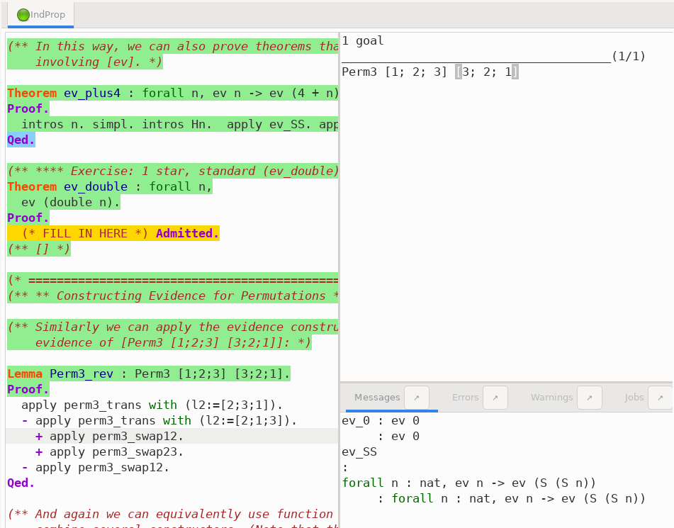
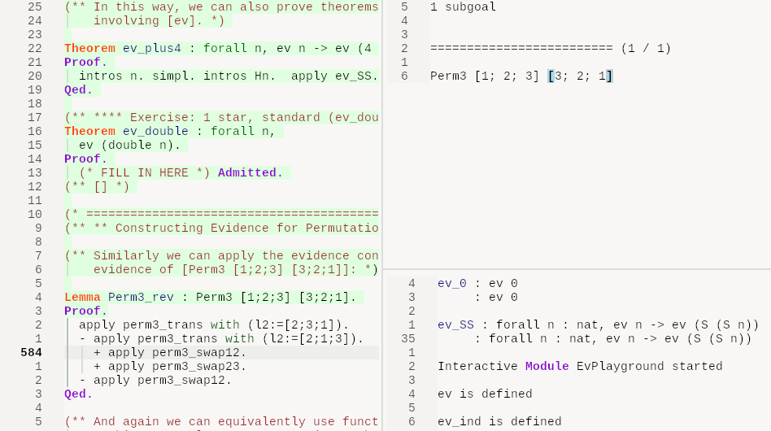

# RocqIDE colors for Neovim / LazyVim

A light colorscheme based on RocqIDE, including Gallina/Ltac syntax highlighting.
Slopped from a sample of 4 screenshots using one of the trending slop machines.
Tweaked to be more readable on my machine with the Noto Mono font family.

## Installation

Put the files in these locations for a vanilla LazyVim setup.  PRs welcome for better installation instructions.

| Project file | Installed location | Purpose |
| --- | --- | --- |
| `rocqide-colorscheme.lua` | `~/.config/nvim/colors/rocqide.lua` | Colorscheme. |
| `rocqide-lexer.vim` | `~/.config/nvim/syntax/rocqide.vim` | Gallina/Ltac lexer. |

## Rocqide Sample

Rocqide

Neovim

